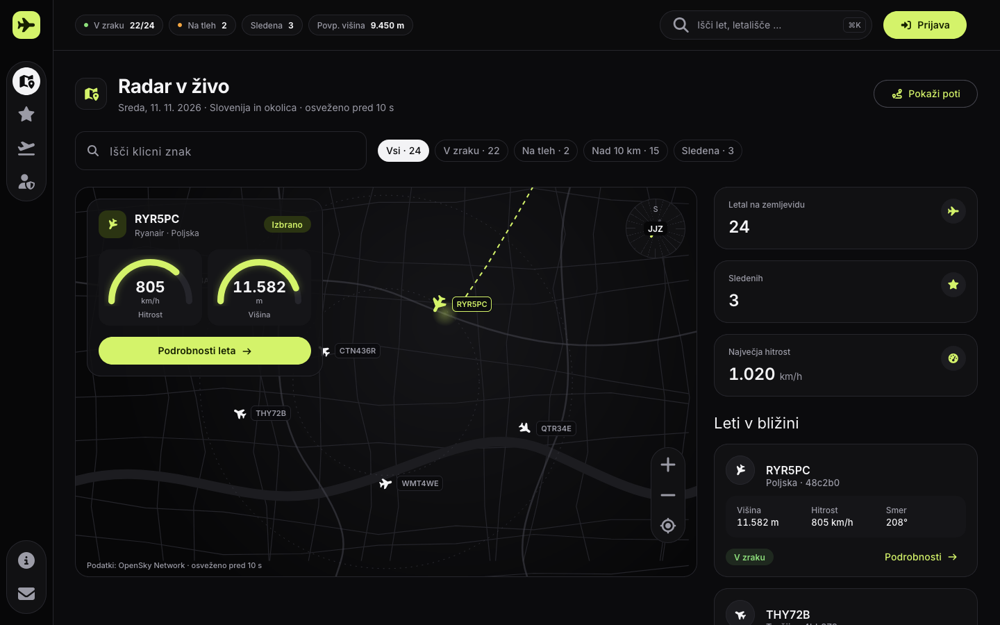

# SkyTrack

Spletni sledilnik letal: zemljevid z letali v živo, podrobnosti posameznega leta in osebni seznam sledenih letal.

Projektna naloga *Načrtovanje spletne aplikacije in izdelava komponentno zasnovanega čelnega dela*. Čelni del je izdelan v Angularju 22 s statično vsebino, z Angular Material in Font Awesome.

## Hiter začetek

Potrebuješ Node.js 24 LTS (ali drugo različico, ki jo podpira Angular CLI 22: `^22.22.3`, `^24.15.0` ali `>=26`).

```bash
npm install
```

```bash
npm start
```

Aplikacija se odpre na <http://localhost:4200>. Prevajanje za preverjanje napak: `npm run build`.

---

## 1. Opis aplikacije

| | |
|---|---|
| **Ime** | SkyTrack (delovno ime) |
| **Kaj je** | Spletni sledilnik letal: zemljevid z letali v živo, podrobnosti posameznega leta in osebni seznam sledenih letal. |
| **Problem** | Ljubitelji letalstva nimajo preprostega, brezplačnega mesta, kjer bi videli, kaj leti nad njimi, in si shranili letala, ki jih zanimajo. Obstoječe storitve večino uporabnih funkcij zaklenejo za naročnino. |
| **Ciljna skupina** | Letalski navdušenci in spotterji; radovedni uporabniki, ki jih zanima "kaj leti nad mano"; dijaki in študenti, ki jih zanima letalstvo. |
| **Jezik vmesnika** | Slovenščina. Imena v kodi (komponente, spremenljivke) so angleška. |

**Obseg te vaje:** samo čelni del v Angularju s statično vsebino. Prijava, vloge, baza, zaledni del in klici na API so načrtovani in dokumentirani, ne pa implementirani.

---

## 2. Uporabniške vloge in pravice

| Zmožnost | Gost | Uporabnik | Administrator |
|---|:-:|:-:|:-:|
| Ogled radarja in seznama letov | ✓ | ✓ | ✓ |
| Ogled podrobnosti leta in letališč | ✓ | ✓ | ✓ |
| Informacijske strani, kontaktni obrazec | ✓ | ✓ | ✓ |
| Registracija in prijava | ✓ | – | – |
| Sledenje letalom, zapiski k letalom | – | ✓ | ✓ |
| Urejanje lastnega profila, odjava | – | ✓ | ✓ |
| Upravljanje uporabnikov (vloge, blokada) | – | – | ✓ |
| Urejanje letališč | – | – | ✓ |
| Pregled prejetih sporočil | – | – | ✓ |

Avtentikacija bo v končni različici potekala prek zalednega dela (registracija, prijava, odjava z žetonom). V tej vaji so obrazci samo vizualni.

---

## 3. Funkcionalnosti

| # | Funkcionalnost | V tej vaji | V končni različici |
|---|---|---|---|
| 1 | **Živi radar** — zemljevid z letali in seznam letov ob njem | Statičen stiliziran zemljevid in kartice z vzorčnimi leti | Pravi zemljevid (Leaflet), podatki iz OpenSky, osveževanje na 10 s |
| 2 | **Filtriranje in iskanje** — klicni znak, država, višina, v zraku / na tleh | Vrstica s polji in čipi brez logike | Filtriranje seznama in zemljevida |
| 3 | **Podrobnosti leta** — višina, hitrost, smer, država, zadnji kontakt | Stran z enim vzorčnim letom | Podatki izbranega letala, izris poti |
| 4 | **Sledenje letalom** — shranjevanje letal in zapiski | Stran s statičnim seznamom sledenih | Shranjevanje v bazo za prijavljenega uporabnika |
| 5 | **Letališča** — seznam in osnovni podatki | Kartice z vzorčnimi letališči | Podatki iz baze, letala v bližini |
| 6 | **Administracija** — uporabniki, letališča, sporočila | Stran z zavihki in statično tabelo | Dejansko upravljanje, dostop samo za administratorja |
| 7 | **Avtentikacija** — registracija, prijava, odjava | Vizualna obrazca | Prava prijava prek zalednega dela |
| 8 | **Informacijske vsebine** — O aplikaciji, Kontakt | Statični strani, obrazec brez pošiljanja | Shranjevanje sporočil v bazo |

Posebne vsebinske funkcionalnosti, ki jih zahteva naloga (vsaj tri): št. 1, 2, 3, 4 in 5.

---

## 4. Podatkovni model

```
User ──1:N── TrackedAircraft ──N:1── Aircraft
User ──1:N── ContactMessage (neobvezno; gost pošlje brez računa)
Airport (samostojna šifrantna tabela)
```

| Entiteta | Polja | Opomba |
|---|---|---|
| **User** | id, ime, email (unikaten), gesloHash, vloga (`user` / `admin`), ustvarjen | Geslo se nikoli ne shrani v berljivi obliki. |
| **Aircraft** | icao24 (ključ), klicniZnak, drzava, tip, operater | `icao24` je enolična 24-bitna oznaka letala iz OpenSky. |
| **TrackedAircraft** | id, userId → User, icao24 → Aircraft, zapisek, opozorilo (da/ne), dodano | Vmesna tabela: uporabnik sledi več letalom, letalu sledi več uporabnikov. |
| **Airport** | id, icao, iata, ime, mesto, drzava, lat, lon | Ureja administrator. |
| **ContactMessage** | id, userId (lahko prazno), ime, email, zadeva, vsebina, stanje (`novo` / `prebrano`), poslano | |

Žive pozicije letal se **ne** shranjujejo v bazo. Zaledni del jih bere iz OpenSky in jih kratko predpomni, da ne porabi dnevne kvote.

---

## 5. Zasloni in navigacija

| Pot | Stran | Vsebina | Kdo |
|---|---|---|---|
| `/` | Radar | Zemljevid, filtri, statistika, seznam letov | vsi |
| `/let/:icao24` | Podrobnosti leta | Mali zemljevid, podatki o letu, zavihki, podobni leti | vsi |
| `/sledena` | Sledena letala | Seznam sledenih, zapiski | uporabnik |
| `/letalisca` | Letališča | Iskanje, kartice letališč | vsi |
| `/prijava` | Prijava | Obrazec | gost |
| `/registracija` | Registracija | Obrazec | gost |
| `/admin` | Administracija | Zavihki: uporabniki, letališča, sporočila | administrator |
| `/o-aplikaciji` | O aplikaciji | Opis, vir podatkov, statistika | vsi |
| `/kontakt` | Kontakt | Kontaktni podatki in obrazec | vsi |

Glava z navigacijo in noga sta na vseh straneh. Na ozkem zaslonu se navigacija skrči v meni (gumb s tremi črtami). Ker v tej vaji ni prijave, so v navigaciji vidne vse povezave.

### Osnutki glavnih zaslonov

Radar (računalnik):

```
┌──────────────────────────────────────────────────────────────┐
│ ✈ SkyTrack   Radar  Sledena  Letališča  O aplikaciji   [Prijava] │
├──────────────────────────────────────────────────────────────┤
│ Radar v živo                                                 │
│ [ Išči klicni znak… ] [Država ▾] (V zraku) (Na tleh) (>10 km)│
├───────────────────────────────────────┬──────────────────────┤
│                                       │ [ 24 letal ][ 3 sled.]│
│            ZEMLJEVID                  │ ┌──────────────────┐ │
│         ✈        ✈                    │ │ RYR5PC  Poljska  │ │
│     ✈         ✈        ✈              │ │ 11 580 m 804 km/h│ │
│                                       │ └──────────────────┘ │
│                                       │ ┌──────────────────┐ │
│                                       │ │ THY72B  Turčija  │ │
│                                       │ └──────────────────┘ │
├───────────────────────────────────────┴──────────────────────┤
│ © SkyTrack · Podatki: OpenSky Network · Kontakt              │
└──────────────────────────────────────────────────────────────┘
```

Podrobnosti leta:

```
┌──────────────────────────────────────────────────────────────┐
│ ← Radar      RYR5PC · Ryanair                    [★ Sledi]   │
├──────────────────────────────┬───────────────────────────────┤
│        MALI ZEMLJEVID        │ [Višina ] [Hitrost] [Smer] [↕]│
│              ✈               │ 11 580 m  804 km/h  208°  0 m/s│
├──────────────────────────────┴───────────────────────────────┤
│ [ Podatki ] [ Pot ] [ Zgodovina ]                            │
│ ICAO24 48c2b0 · Država Poljska · Squawk 1000 · Zadnji kontakt│
├──────────────────────────────────────────────────────────────┤
│ Podobni leti:  [kartica leta] [kartica leta] [kartica leta]  │
└──────────────────────────────────────────────────────────────┘
```

Sledena letala:

```
┌──────────────────────────────────────────────────────────────┐
│ Sledena letala                                               │
│ [ Sledena (3) ] [ Zapiski ]                                  │
│ ┌────────────────┐ ┌────────────────┐ ┌────────────────┐     │
│ │ QTR34E  Katar  │ │ CTN436R Hrvaška│ │ TVF44AG Francija│    │
│ │ 10 058 m       │ │ 2 446 m        │ │ 11 270 m       │     │
│ │ "A350, lep!"   │ │                │ │                │     │
│ └────────────────┘ └────────────────┘ └────────────────┘     │
└──────────────────────────────────────────────────────────────┘
```

Prijava (telefon):

```
┌───────────────────┐
│ ✈ SkyTrack     ☰ │
├───────────────────┤
│      Prijava      │
│ ┌───────────────┐ │
│ │ E-pošta       │ │
│ └───────────────┘ │
│ ┌───────────────┐ │
│ │ Geslo         │ │
│ └───────────────┘ │
│ [    Prijava    ] │
│ Nimaš računa?     │
│ Registracija      │
├───────────────────┤
│ © SkyTrack        │
└───────────────────┘
```

Osnutki so shranjeni tudi kot slike v mapi [`docs/osnutki/`](docs/osnutki/): [Radar](docs/osnutki/1-radar.png), [Podrobnosti leta](docs/osnutki/2-podrobnosti-leta.png), [Sledena letala](docs/osnutki/3-sledena-letala.png), [Prijava (telefon)](docs/osnutki/4-prijava-telefon.png). Končni videz je na posnetkih zaslona v razdelku 14.

---

## 6. Angular komponente

Skupaj **22 lastnih komponent** (zahtevanih 8), od tega **10 uporabljenih na več mestih** (zahtevani 2). Komponente InfoCard, MessageCard in EmptyState so nastale v 4. fazi pri pregledu podvajanja, Gauge pri prenovi videza.

### Hierarhija

```
App
├─ Header
│   └─ Navbar
├─ <router-outlet>
│   ├─ RadarPage ........ PageTitle, SearchFilterBar, MapView, Gauge ×2, StatTile ×3, FlightCard ×6
│   ├─ FlightDetailPage . PageTitle, MapView, Gauge ×2, StatTile ×2, FlightCard ×3, EmptyState
│   ├─ TrackedPage ...... PageTitle, FlightCard ×3, MessageCard ×2, EmptyState
│   ├─ AirportsPage ..... PageTitle, SearchFilterBar, AirportCard ×4
│   ├─ LoginPage ........ PageTitle
│   ├─ RegisterPage ..... PageTitle
│   ├─ AdminPage ........ PageTitle, StatTile ×3, MessageCard ×3
│   ├─ AboutPage ........ PageTitle, StatTile ×3, InfoCard ×4
│   └─ ContactPage ...... PageTitle, InfoCard ×2
└─ Footer
```

### Seznam

| Komponenta | Selektor | Mapa | Namen | Uporabljena v |
|---|---|---|---|---|
| Header | `app-header` | `layout/` | Zgornja vrstica: stanje zračnega prostora, iskanje, prijava | App |
| Navbar | `app-navbar` | `layout/` | Levi pas ikon (računalnik) oziroma meni (telefon) | Header |
| Footer | `app-footer` | `layout/` | Avtorstvo, vir podatkov, povezave | App |
| **PageTitle** | `app-page-title` | `shared/` | Naslov in podnaslov strani z ikono | vseh 9 strani |
| **FlightCard** | `app-flight-card` | `shared/` | Kartica leta: klicni znak, država, višina, hitrost | Radar, Podrobnosti, Sledena |
| **StatTile** | `app-stat-tile` | `shared/` | Ploščica z eno številko in oznako | Radar, Podrobnosti, Admin, O aplikaciji |
| **SearchFilterBar** | `app-search-filter-bar` | `shared/` | Iskalno polje in čipi za filtre | Radar, Letališča |
| **MapView** | `app-map-view` | `shared/` | Stiliziran temen zemljevid z letali, kompasom in lebdečo kartico | Radar (velik), Podrobnosti (majhen) |
| **AirportCard** | `app-airport-card` | `shared/` | Kartica letališča: koda, ime, mesto | Letališča (×4) |
| **InfoCard** | `app-info-card` | `shared/` | Kartica z ikono, naslovom in poljubno vsebino | O aplikaciji (×4), Kontakt (×2) |
| **MessageCard** | `app-message-card` | `shared/` | Sporočilo ali zapisek z avtorjem, datumom in stanjem | Admin (×3), Sledena (×2) |
| **EmptyState** | `app-empty-state` | `shared/` | Prikaz, ko ni podatkov | Podrobnosti leta (Pot), Sledena (Opozorila) |
| **Gauge** | `app-gauge` | `shared/` | Polkrožni merilnik (hitrost, višina) | Radar (×2), Podrobnosti leta (×2) |
| RadarPage | `app-radar-page` | `pages/` | Domača stran | usmerjevalnik |
| FlightDetailPage | `app-flight-detail-page` | `pages/` | Podrobnosti enega leta | usmerjevalnik |
| TrackedPage | `app-tracked-page` | `pages/` | Sledena letala in zapiski | usmerjevalnik |
| AirportsPage | `app-airports-page` | `pages/` | Seznam letališč | usmerjevalnik |
| LoginPage | `app-login-page` | `pages/` | Obrazec za prijavo | usmerjevalnik |
| RegisterPage | `app-register-page` | `pages/` | Obrazec za registracijo | usmerjevalnik |
| AdminPage | `app-admin-page` | `pages/` | Administracija z zavihki | usmerjevalnik |
| AboutPage | `app-about-page` | `pages/` | O aplikaciji | usmerjevalnik |
| ContactPage | `app-contact-page` | `pages/` | Kontaktni podatki in obrazec | usmerjevalnik |

Postavitvene in skupne komponente se vključujejo s selektorji v nadrejene predloge. Strani se menjajo z Angular usmerjevalnikom.

Različna vsebina v ponovno uporabljenih komponentah (npr. drug klicni znak v vsaki kartici) se poda z vhodnimi podatki (`input()`); glej odprto vprašanje v razdelku 13.

---

## 7. Angular Material in Font Awesome

**Angular Material** — 8 vrst komponent (zahtevane 4):

| Komponenta | Kje |
|---|---|
| Toolbar (`mat-toolbar`) | Header (zgornja vrstica) |
| Button (`mat-button`, `mat-flat-button`, `mat-stroked-button`, `mat-icon-button`) | Navbar, Header, obrazci, kartice, zemljevid |
| Card (`mat-card`) | FlightCard, AirportCard, StatTile, InfoCard, obrazci, lebdeča kartica na zemljevidu |
| Form field + Input (`mat-form-field`, `matInput`) | Prijava, Registracija, Kontakt, SearchFilterBar |
| Tabs (`mat-tab-group`) | Podrobnosti leta, Sledena, Admin |
| Menu (`mat-menu`) | Navbar na ozkem zaslonu (gumb s tremi črtami) |
| Tooltip (`matTooltip`) | Navbar: opisi ikon v levem pasu |
| Chips (`mat-chip-listbox`, `mat-chip-set`) | filtri (Radar, Letališča), oznake stanja (FlightCard, MessageCard, Admin) |

**Font Awesome** — vsaj 12 ikon (zahtevanih 5), uvoženih v TypeScript in prikazanih s `<fa-icon>`:

| Ikona | Kje |
|---|---|
| `faPlane` | logotip, ikone letal na zemljevidu, FlightCard |
| `faMapLocationDot` | Navbar (Radar), naslov strani Radar |
| `faStar` | Navbar (Sledena), gumb Sledi |
| `faPlaneDeparture` | Navbar (Letališča), AirportCard |
| `faMagnifyingGlass` | SearchFilterBar |
| `faUser` | obrazca Registracija |
| `faRightToBracket` | gumb Prijava |
| `faGaugeHigh` | StatTile (največja hitrost, kvota) |
| `faCompass` | StatTile (smer) |
| `faEnvelope` | Kontakt, noga |
| `faBars` | meni na telefonu |
| `faUserShield` | Admin |

Poleg teh je uporabljenih še 22 ikon: `faAddressCard`, `faArrowLeft`, `faArrowRight`, `faArrowsUpDown`, `faBan`, `faBell`, `faCircleInfo`, `faClock`, `faCode`, `faDatabase`, `faEnvelopeOpen`, `faLocationCrosshairs`, `faLock`, `faMinus`, `faNoteSticky`, `faPaperPlane`, `faPen`, `faPlus`, `faRoute`, `faTrash`, `faUserPlus`, `faUsers` (skupaj 34).

Brez oznak `<i class="fa …">` in brez CDN povezav.

---

## 8. Videz in odzivnost

- **Slog:** temna, nevtralna nadzorna plošča (zgled: posnetek "Haulix" na Dribbblu, prevzet je samo slog, ne vsebina). Skoraj črno ozadje, oglje-sive kartice z velikim polmerom in tanko obrobo, en limetin poudarek (`#d4f36a`) za glavna dejanja in izbrano stanje. Oznake stanja: zelena (v redu), oranžna (opozorilo), rdeča (napaka).
- **Tema:** Angular Material 3, vse barve in prilagoditve komponent (kartice, gumbi v obliki tabletke, čipi, polja, zavihki, namigi) so določene enkrat v `styles.scss`; komponente ne vsebujejo svojih barvnih vrednosti.
- **Tipografija:** Inter (Google Fonts); številke z enako širokimi števkami.
- **Razmiki:** enotna lestvica 4 / 8 / 16 / 24 / 32 px.
- **Postavitev:** na računalniku ozek pas ikon na levi (z namigi), zgoraj vrstica s stanjem zračnega prostora, iskanjem in prijavo.
- **Prelomne točke:**
  - do 600 px: en stolpec, nižji zemljevid, lebdeča kartica na zemljevidu skrita;
  - 600–960 px: dva stolpca kartic;
  - pod 960 px: navigacija v meniju (gumb s tremi črtami), logotip v zgornji vrstici;
  - od 960 px: levi pas ikon, iskalno polje in gumb Prijava v zgornji vrstici;
  - od 1200 px: zemljevid in seznam letov drug ob drugem, tabletke s stanjem v zgornji vrstici.
- **Zemljevid:** lasten stiliziran SVG (ulice, glavne ceste, reka, krogi dosega, pot izbranega leta), ikone letal postavljene in zasukane s CSS, kompas in gumbi za povečavo. Brez zunanjih slik, zato ni vprašanj glede licenc. Utripanje izbranega letala se ob nastavitvi "zmanjšaj gibanje" izklopi.

---

## 9. Vir podatkov: OpenSky Network

Izbran s seznama [public-apis → Transportation](https://github.com/public-apis/public-apis#transportation). Dokumentacija: <https://openskynetwork.github.io/opensky-api/rest.html>.

**Preverjeno 11. 11. 2026 z živim klicem** (brez računa in brez ključa):

```
GET https://opensky-network.org/api/states/all?lamin=45.3&lomin=13.3&lamax=46.9&lomax=16.7
→ HTTP 200, seznam letal nad Slovenijo in okolico, x-rate-limit-remaining: 399
```

| Lastnost | Vrednost |
|---|---|
| Cena | Brezplačno |
| Kvota | 400 kreditov/dan anonimno; 4000/dan z brezplačnim računom |
| Cena klica | 1–4 krediti za `/states/all`, odvisno od velikosti območja |
| Ločljivost | 10 sekund za anonimne uporabnike, samo trenutno stanje |
| Prijava | Neobvezna. Z računom: OAuth2 (client credentials), žeton velja 30 minut |
| Podatki | icao24, klicni znak, država, zemljepisna dolžina in širina, višina, hitrost, smer, hitrost vzpenjanja, na tleh, squawk |
| Česa ni | Vozni redi, zamude, odhodno/prihodno letališče v živo |

**Omejitvi, ki vplivata na arhitekturo:**

1. **CORS.** Strežnik vrne `access-control-allow-origin: https://opensky-network.org`, zato brskalnik klica iz Angular aplikacije zavrne. Klice mora posredovati Node.js zaledni del (v razvoju lahko tudi Angular proxy).
2. **Kvota.** 400 kreditov na dan ne zadošča za osveževanje na 10 s pri vsakem obiskovalcu. Zaledni del zato kliče OpenSky enkrat in odgovor predpomni za vse.

**Pogoji uporabe:** uradne strani s pogoji ni bilo mogoče odpreti (HTTP 403). Po drugih virih je brezplačna uporaba namenjena nekomercialni, raziskovalni in izobraževalni rabi z navedbo vira; pred objavo aplikacije to preveri pri viru. V nogi aplikacije je naveden vir "Podatki: OpenSky Network".

Zavrnjene možnosti: **aviationstack** (brezplačno samo 100 klicev na mesec), **ADS-B Exchange** (samo plačljive naročnine). **AirportMiles** (statični podatki o letališčih, brezplačno, brez ključa) je uporaben kot dopolnilo za šifrant letališč.

---

## 10. Potrebe za razvoj

### Orodja

| Orodje | Potrebno | Uporabljeno pri razvoju |
|---|---|---|
| Node.js | `^22.22.3`, `^24.15.0` ali `>=26` (zahteva Angular CLI 22) | 24.22.2 LTS |
| npm | priložen Node.js | 11.19.1 |
| Angular CLI | 22.x | 22.2.6 |
| Git | katerakoli novejša | 2.50.1 |
| Brskalnik | Chrome ali Edge z razvijalskimi orodji | za preverjanje na telefonski širini |
| Urejevalnik | VS Code + razširitev Angular Language Service | priporočeno |

Namestitev Node 24 LTS na macOS s Homebrew (če je nameščena druga različica, jo `brew unlink` izklopi):

```bash
brew install node@24
```

```bash
brew unlink node && brew link --overwrite --force node@24
```

Namestitev Angular CLI:

```bash
npm install -g @angular/cli@22
```

### Paketi projekta

| Paket | Različica (preverjeno 11. 11. 2026) | Namen |
|---|---|---|
| `@angular/core` in ostali | 22.x | ogrodje |
| `@angular/material`, `@angular/cdk` | 22.2.6 | komponente vmesnika |
| `@fortawesome/angular-fontawesome` | 5.1.0 (zahteva Angular 22) | komponenta `<fa-icon>` |
| `@fortawesome/fontawesome-svg-core` | 7.3.1 | jedro ikon |
| `@fortawesome/free-solid-svg-icons` | 7.3.1 | brezplačne ikone |

### Namestitev in zagon projekta

```bash
npm install
```

```bash
npm start
```

Aplikacija je nato na <http://localhost:4200>. Prevajanje za preverjanje napak: `ng build`.

### Računi in storitve

| Kaj | Zakaj | Kdaj |
|---|---|---|
| GitHub račun in repozitorij, dostopen učitelju | oddaja izvorne kode | pred prvo objavo kode |
| GitHub Projects tabla | načrt dela in spremljanje nalog | takoj |
| OpenSky račun (neobvezno) | 4000 namesto 400 kreditov na dan | šele z zalednim delom |

### Za poznejši razvoj (ni del te vaje)

Node.js z Express za zaledni del, podatkovna baza (glej razdelek 13), Leaflet 1.9.4 za pravi zemljevid, knjižnica za zgoščevanje gesel in žetone JWT.

---

## 11. Izvedba po fazah

Faze sledijo šestim tednom iz navodil naloge. Izvedba je lahko hitrejša, vrstni red pa ostane.

| Faza | Naloga | Opis | Stanje |
|---|---|---|---|
| 1 | Načrt aplikacije | Ta dokument: opis, vloge, funkcionalnosti, podatkovni model | zaključeno |
| 1 | Izbira API-ja | Izbira in preverjanje OpenSky Network | zaključeno |
| 1 | Osnutki zaslonov | Osnutke iz razdelka 5 pretvoriti v slike ali PDF | zaključeno |
| 1 | Tabla nalog | Ustvariti GitHub Projects tablo in vnesti naloge iz te tabele | načrtovano |
| 1 | Okolje | Namestiti Node 24 in Angular CLI | zaključeno |
| 1 | Angular projekt | `ng new`, prvi commit, osnovni `README.md` | zaključeno |
| 2 | Postavitev | Header, Navbar, Footer, usmerjanje, prazne strani | zaključeno |
| 2 | Skupne komponente | PageTitle, FlightCard, StatTile, SearchFilterBar, MapView, AirportCard | zaključeno |
| 2 | Osnovni prikazi | Radar, Podrobnosti leta, Sledena, Letališča s statično vsebino | zaključeno |
| 3 | Obrazci | Prijava, Registracija, Kontakt | zaključeno |
| 3 | Preostale strani | Admin, O aplikaciji | zaključeno |
| 3 | Slog | Barvna shema, tipografija, razmiki | zaključeno |
| 3 | Odzivnost | Prelomne točke, navigacija na telefonu | zaključeno |
| 4 | Pregled podvajanja | Odstraniti podvojen HTML in CSS, po potrebi nove skupne komponente | zaključeno |
| 4 | Dodelava | Vizualna hierarhija, prazna stanja, dostopnost (kontrast, oznake polj) | zaključeno |
| 5 | Angular Material | Namestitev, tema, 8 vrst komponent | zaključeno |
| 5 | Font Awesome | Namestitev, uvoz ikon v TypeScript, `<fa-icon>` | zaključeno |
| 6 | Preverjanje | Prevajanje brez napak, pregled vseh strani na računalniku in telefonu | zaključeno |
| 6 | Dokumentacija | Dokončan `README.md` z vsemi zahtevanimi razdelki | zaključeno |
| 6 | Oddaja | Posnetki zaslona, posodobljena tabla, objava repozitorija, predstavitev | delno: posnetki narejeni; tabla, objava in predstavitev odprte |

Naloga zahteva v `README.md` tedenski dnevnik (načrtovano, izdelano, težave, kaj sledi). Dnevnik se piše po fazah z dejanskim potekom dela; datume vpišeš sam.

### Preverjanje minimalnih zahtev

| Zahteva | Minimum | Načrt |
|---|---|---|
| Lastne komponente | 8 | 22 |
| Komponente na več mestih | 2 | 10 |
| Različni vsebinski prikazi | 4 | 9 strani |
| Vrste Material komponent | 4 | 8 |
| Font Awesome ikone | 5 | 34 |
| Uporabniške vloge | 2 | 3 |
| Vsebinske funkcionalnosti | 3 | 5 |
| Odzivnost | osnovna | 3 prelomne točke |

---

## 12. Nadaljnji razvoj (ni implementirano v tej vaji)

1. Node.js zaledni del z REST API-jem.
2. Podatkovna baza po modelu iz razdelka 4.
3. Registracija, prijava in odjava; zaščita poti glede na vlogo.
4. Posrednik do OpenSky s predpomnilnikom; osveževanje radarja.
5. Pravi zemljevid (Leaflet) namesto stiliziranega SVG.
6. Delujoče filtriranje in iskanje.
7. Shranjevanje sledenih letal in zapiskov.
8. Opozorilo, ko sledeno letalo vzleti ali pristane.
9. Administracija z dejanskim urejanjem podatkov.
10. Dinamični seznami (`@for`, `@if`) namesto statično ponovljenih komponent.

---

## 13. Odprta vprašanja

| Vprašanje | Privzeta odločitev, če ni odgovora |
|---|---|
| Ali smejo komponente uporabljati vhodne podatke (`input()`)? Navodila dopuščajo tudi ponovitev z enako statično vsebino. | Da, preprost `input()` za besedilo v PageTitle, FlightCard, StatTile, AirportCard. |
| Ali je usmerjevalnik (več strani) v redu za učitelja? | Da. |
| Ali ostane ime SkyTrack? | Da. |
| Katera baza za končno različico? | Tista, ki jo obravnavate pri predmetu; model iz razdelka 4 ustreza obema vrstama. |
| Kje bo projekt na disku in kako se imenuje repozitorij? | Vprašati pred `ng new`. |


---

## 14. Posnetki zaslona

Posnetki vseh 9 strani na širini računalnika (1440 × 900) in telefona (375 × 812) so v mapi [`docs/posnetki/`](docs/posnetki/).



| Stran | Računalnik | Telefon |
|---|---|---|
| Radar | [računalnik](docs/posnetki/01-radar-racunalnik.png) | [telefon](docs/posnetki/01-radar-telefon.png) |
| Podrobnosti leta | [računalnik](docs/posnetki/02-podrobnosti-leta-racunalnik.png) | [telefon](docs/posnetki/02-podrobnosti-leta-telefon.png) |
| Sledena letala | [računalnik](docs/posnetki/03-sledena-racunalnik.png) | [telefon](docs/posnetki/03-sledena-telefon.png) |
| Letališča | [računalnik](docs/posnetki/04-letalisca-racunalnik.png) | [telefon](docs/posnetki/04-letalisca-telefon.png) |
| Prijava | [računalnik](docs/posnetki/05-prijava-racunalnik.png) | [telefon](docs/posnetki/05-prijava-telefon.png) |
| Registracija | [računalnik](docs/posnetki/06-registracija-racunalnik.png) | [telefon](docs/posnetki/06-registracija-telefon.png) |
| Administracija | [računalnik](docs/posnetki/07-admin-racunalnik.png) | [telefon](docs/posnetki/07-admin-telefon.png) |
| O aplikaciji | [računalnik](docs/posnetki/08-o-aplikaciji-racunalnik.png) | [telefon](docs/posnetki/08-o-aplikaciji-telefon.png) |
| Kontakt | [računalnik](docs/posnetki/09-kontakt-racunalnik.png) | [telefon](docs/posnetki/09-kontakt-telefon.png) |

---

## 15. Dnevnik dela

Dnevnik se piše po fazah. Datume vpiši sam.

### Faza 1 — Načrt in postavitev projekta (datum: ____)

- **Načrtovano:** načrt aplikacije, izbira API-ja, osnutki zaslonov, tabla nalog, razvojno okolje, Angular projekt.
- **Izdelano:** načrt (razdelki 1–13), izbran in preverjen OpenSky Network, nameščena Node.js 24 LTS in Angular CLI 22.2.6, ustvarjen Angular projekt (SCSS, usmerjevalnik, brez SSR, brez zone.js), nameščena Angular Material 22.2.6 in Font Awesome (angular-fontawesome 5.1.0, ikone 7.3.1), pripravljene mape `layout/`, `shared/`, `pages/`.
- **Težave:** na računalniku je bil Node.js 25, ki ga Angular CLI 22 ne podpira; zamenjan z Node.js 24 LTS. Uradnih pogojev uporabe OpenSky ni bilo mogoče odpreti (HTTP 403).
- **Kaj sledi:** osnutki zaslonov kot slike ali PDF, GitHub Projects tabla, nato faza 2 (postavitev in skupne komponente).

### Faza 2 — Postavitev, skupne komponente in osnovni prikazi (datum: ____)

- **Načrtovano:** Header, Navbar, Footer, usmerjanje med 9 stranmi, šest skupnih komponent, vsebina strani Radar, Podrobnosti leta, Sledena letala in Letališča.
- **Izdelano:** vseh 18 komponent; postavitev z `mat-toolbar` in povezavami usmerjevalnika; skupne komponente PageTitle, FlightCard, StatTile, SearchFilterBar, MapView (lasten SVG zemljevid) in AirportCard z vhodnimi podatki (`input()`); štiri strani z vzorčnimi podatki iz OpenSky; preostalih pet strani ima naslov in čaka na fazo 3. Material (toolbar, button, card, chips, form field, tabs) in Font Awesome sta vgrajena sproti.
- **Težave:** začetni paket je presegel omejitev 500 kB; rešeno z nalaganjem strani po potrebi (`loadComponent`). Brez `@if` se prazni deli (npr. kartica brez zapiska) skrijejo s CSS `:empty`.
- **Kaj sledi:** obrazci (Prijava, Registracija, Kontakt), strani Admin in O aplikaciji, temna tema, navigacija na telefonu.

### Faza 3 — Obrazci, preostale strani, slog in odzivnost (datum: ____)

- **Načrtovano:** obrazci za prijavo, registracijo in kontakt; strani Admin in O aplikaciji; barvna shema, tipografija in razmiki; prelomne točke in navigacija na telefonu.
- **Izdelano:** temna "radarska" tema (Material 3, temno modre površine, jantarni poudarek, cian za radarske kroge), vse barve na enem mestu v `styles.scss`; skupni razredi za obrazce, tabele in mreže kartic; trije vizualni obrazci; Admin z zavihki (uporabniki, letališča, sporočila) in navadnimi tabelami; O aplikaciji s ploščicami in karticami; meni z `mat-menu` pod 960 px, preklop samo s CSS; prelomni točki 600 in 960 px.
- **Težave:** Material meni je povečal začetni paket na 544 kB, kar je nad privzeto mejo opozorila 500 kB; meja je dvignjena na 750 kB (napaka ostane pri 1 MB). Navigacija s petimi povezavami ne gre v eno vrstico že pod 960 px, zato je meni uporabljen do te širine in ne samo do 600 px.
- **Kaj sledi:** pregled podvajanja HTML in CSS, dodelava vizualne hierarhije in dostopnosti.

### Faza 4 — Pregled podvajanja in dodelava (datum: ____)

- **Načrtovano:** odstraniti podvojen HTML in CSS, po potrebi nove skupne komponente; dodelati vizualno hierarhijo, prazna stanja in dostopnost.
- **Izdelano:**
  - Tri nove skupne komponente: **InfoCard** (namesto štirih enakih kartic v O aplikaciji in dveh v Kontaktu), **MessageCard** (namesto ponovljenih sporočil v Adminu in zapiskov v Sledenih) in **EmptyState** (zavihek Pot pri letu, nov zavihek Opozorila pri Sledenih).
  - Ponavljajoči se slogi so preseljeni v `styles.scss` kot skupni razredi (`stat-grid`, `tab-body`, `card-body`, `full-height`, `prose`, `field-icon`, `data-table`); FlightCard in AirportCard nimata več lastnih kopij istih pravil.
  - Dostopnost: povezava "Preskoči na vsebino", `aria-current` na aktivni povezavi, noga kot `<nav>`, obvezna polja (`required`) v obrazcih, naslovi kartic kot `<h2>`, jasno viden fokus s tipkovnico. Kontrast besedila je preverjen na vseh 9 straneh (vse ustreza WCAG AA).
  - Vizualna hierarhija: podnaslovi kartic manj poudarjeni od naslovov.
- **Težave:** povezave v navigaciji so v predlogi zapisane dvakrat (vrstica za računalnik in meni za telefon). Brez `@for` se temu ni mogoče izogniti, zato je podvajanje ostalo namerno. Prazna stanja so prikazana kot statični primer, saj brez `@if` ni pogojnega prikaza.
- **Kaj sledi:** faza 5 (Angular Material in Font Awesome sta že vgrajena sproti; preveriti in dokumentirati), faza 6 (preverjanje, posnetki zaslona, oddaja).

### Prenova videza (datum: ____)

- **Načrtovano:** sodobnejši, bolj "nadzorni" videz po zgledu posnetka "Haulix" (Phenomenon Studio) na Dribbblu; prevzet je samo slog, ne vsebina ali blagovna znamka.
- **Izdelano:** nevtralna temna tema s skoraj črnim ozadjem in limetinim poudarkom, pisava Inter, prilagoditve Material komponent na enem mestu (kartice, gumbi v obliki tabletke, čipi, polja, zavihki, namigi); ozek levi pas ikon z `matTooltip` namesto vodoravne navigacije; zgornja vrstica s stanjem zračnega prostora, iskanjem in prijavo; nov zemljevid (ulice, ceste, reka, pot izbranega leta, kompas, gumbi za povečavo, lebdeča kartica); nova skupna komponenta **Gauge** (polkrožni merilnik); barvne oznake stanj (zelena, oranžna, rdeča, limetina).
- **Težave:** `backdrop-filter` na glavi je fiksiranemu levemu pasu spremenil izhodišče in pas je prekril vsebino, rešeno z zameglitvijo na psevdoelementu. Po dodani odvisnosti (Tooltip) je razvojni strežnik naložil dve kopiji `@angular/core` (napaka NG0203), rešeno s ponovnim zagonom in počiščenim `.angular/cache`. Na ozkih karticah so se meritve prekrivale, rešeno s prelomom v več vrstic.
- **Kaj sledi:** faza 5 in 6.

### Faza 5 — Angular Material in Font Awesome (datum: ____)

- **Načrtovano:** namestitev in tema Angular Material, vsaj 4 vrste komponent; Font Awesome prek `@fortawesome/angular-fontawesome`, vsaj 5 ikon.
- **Izdelano:** obe knjižnici sta bili vgrajeni sproti od faze 2 naprej. Pregled: 8 vrst Material komponent (Toolbar, Button, Card, Form field + Input, Tabs, Menu, Tooltip, Chips), tema Material 3 s prilagoditvami v `styles.scss`; 34 ikon Font Awesome, vse uvožene v TypeScript in prikazane s `<fa-icon>`, brez `<i class="fa">` in brez CDN.
- **Težave:** `mat-table` ni uporabljen, ker zahteva strukturne direktive (`*matRowDef`), ki jih ta vaja ne dovoljuje; tabele so navadne `<table>` v `mat-card`.
- **Kaj sledi:** končno preverjanje in oddaja.

### Faza 6 — Preverjanje in dokumentacija (datum: ____)

- **Načrtovano:** prevajanje brez napak, pregled vseh strani na računalniku in telefonu, dokončan README, posnetki zaslona, oddaja.
- **Izdelano:** `ng build` brez napak in opozoril; vseh 9 poti pregledanih na 1440 px in 375 px (brez vodoravnega drsenja, brez napak v konzoli, kontrast besedila ustreza WCAG AA); v kodi ni `@if`, `@for`, `*ngIf`, `*ngFor` in `class="fa`; 18 posnetkov zaslona v `docs/posnetki/` (Firefox brez okna); osnutki zaslonov kot slike v `docs/osnutki/`; README dopolnjen.
- **Težave:** brez posebnosti.
- **Kaj sledi:** GitHub Projects tabla, objava repozitorija na GitHubu, predstavitev.
